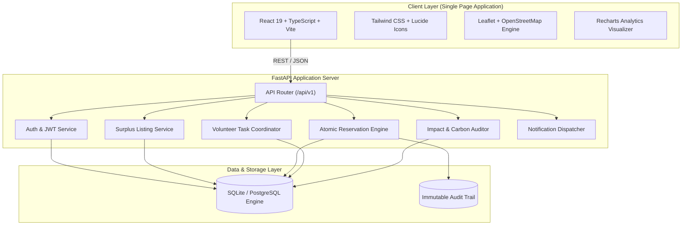
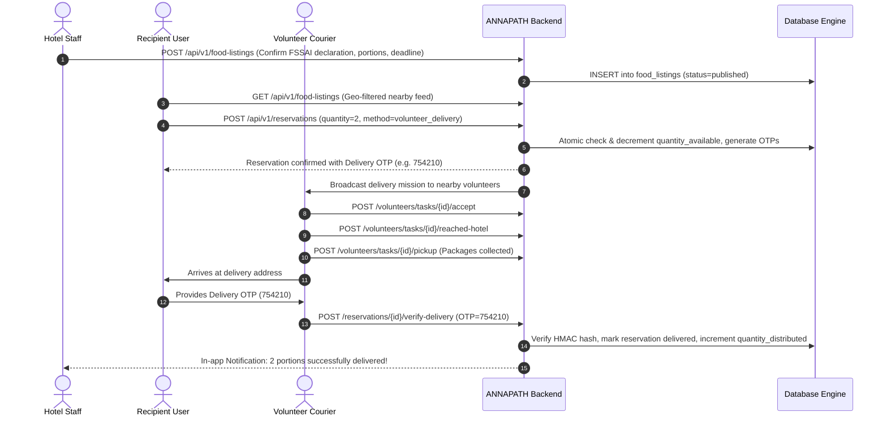
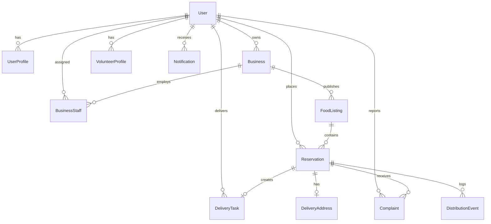

# ANNAPATH — System Architecture & Technical Design

## 1. High-Level System Architecture

---

## 2. End-to-End Operational Lifecycle

---

## 3. Database Entity Relationship Diagram (ERD)

---

## 4. Key Architectural Patterns

1. **Atomic Inventory Protection:**
   Inventory decrement is executed within a database transaction with SQLite WAL mode / row-level locks, ensuring `quantity_available` never drops below zero even during simultaneous reservation clicks.
2. **Cryptographic OTP Hashing:**
   Plaintext OTPs are never stored in the database. Instead, HMAC-SHA256 digests (`pickup_otp_hash` and `delivery_otp_hash`) are persisted, making database inspection immune to credential harvesting.
3. **Unified Single-Port Deployment:**
   FastAPI mounts the compiled static assets (`frontend/dist`) at runtime, serving both the RESTful API endpoints, Swagger UI documentation, and the full React Single Page Application on a single host and port (`http://127.0.0.1:8000`).
